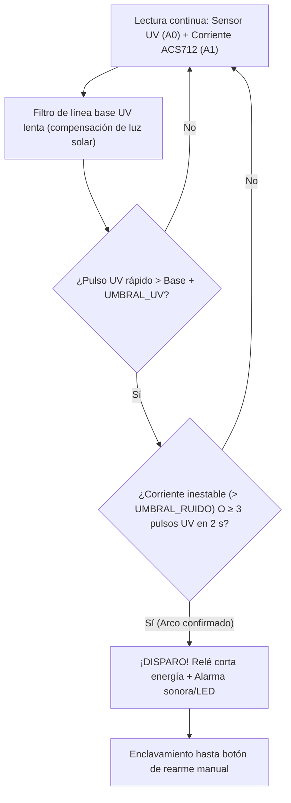

# Cazachispas UV: detector de arcos eléctricos por fotones ultravioleta

[-f59e0b?style=for-the-badge)](#archivos-del-repositorio)

> *"Vemos la chispa antes que el fuego."*  
> Proyecto escolar de **Innova Schools** para **"El Gran Reto"** (*Circuitos eléctricos: uso eficiente y seguro de la electricidad*).

---

## ⚡ Descripción General

Prototipo electrónico de bajo costo (**$\approx\text{S/ }180$** con maqueta de demostración; **núcleo electrónico $\approx\text{S/ }70$**) diseñado para detectar la chispa de un **arco eléctrico serie/paralelo** a través de su emisión de **fotones ultravioleta** ($337\text{ nm}$, segundo sistema positivo del nitrógeno atmosférico $\text{N}_2$) y **confirmar el evento mediante el ruido de alta variación en la corriente eléctrica**. Cuando se cumple la condición de alarma, un módulo de relé desconecta inmediatamente la carga y exige rearme manual.

> [!IMPORTANT]
> **Estado del proyecto:** Diseño electrónico, firmware para Arduino (`.ino`), informe tecnológico completo y simulador interactivo. **Las tablas de pruebas experimentales de la sección 9 del informe aún están en blanco para llenarse con mediciones físicas**; no se declara ninguna tasa de aciertos ni tiempo de desconexión medido.

👉 **[Probar el Simulador Interactivo en Vivo](https://mathigza1211.github.io/cazachispas-uv/)** *(incluye Serial Plotter en vivo, inyección de fallas eléctricas y panel de física cuántica del fotodiodo).*

---

## 🧠 Lógica de Detección en Doble Canal

### Características del Simulador Web y del Firmware

| Componente | Detalle Técnico |
| :--- | :--- |
| **Física del Sensor (QED / Estado Sólido)** | Explica por qué el fotón UV del arco de $\text{N}_2$ ($337\text{ nm} \approx 3.68\text{ eV}$) supera la brecha prohibida (*bandgap*) del semiconductor $\text{GaN/AlGaN}$ ($\approx 3.4\text{ eV}$), mientras que la luz visible doméstica no genera par electrón–hueco. |
| **Escenarios de Prueba Simulados** | Permite provocar **empalme flojo**, **chispa intermitente**, **encendedor de arco** o variaciones de luz ambiental y observar la respuesta del algoritmo de Arduino en un **Serial Plotter** en tiempo real. |
| **Firmware Listo para Calibrar** | [`cazachispas_uv.ino`](cazachispas_uv.ino) implementa promedio móvil exponencial para la línea base solar, ventana temporal deslizante de $2\text{ s}$ y constantes ajustables `UMBRAL_UV` y `UMBRAL_RUIDO`. |

---

## ⚠️ Límites de Seguridad y Operación

> [!CAUTION]
> - **Prototipo educativo de 12 V DC:** Este circuito **no reemplaza** un interruptor diferencial ni un interruptor de falla de arco certificado (**AFCI**). **Jamás debe conectarse directamente a la red de 220 V AC** sin aislamiento y supervisión de un electricista colegiado.
> - **Línea de vista y tiempo de respuesta:** El sensor óptico requiere ver la chispa (o su reflejo dentro de la caja de paso); además, los módulos UV analógicos económicos tienen constantes de tiempo de $\approx 0.5\text{ s}$, por lo que un micro-arco único y fugaz puede no cruzar el umbral.
> - **Calibración in situ:** La radiación UV solar directa puede elevar el fondo; es indispensable calibrar los umbrales en el entorno real de montaje.

---

## 📄 Archivos del Repositorio

| Archivo | Descripción |
| :--- | :--- |
| [`index.html`](index.html) | Simulador interactivo del circuito, Serial Plotter y panel de física del fotodiodo UV. |
| [`cazachispas_uv.ino`](cazachispas_uv.ino) | Código fuente para **Arduino Uno / Nano** con lógica adaptativa y enclavamiento de seguridad. |
| [`Cazachispas_UV_Informe_tecnologico.pdf`](Cazachispas_UV_Informe_tecnologico.pdf) | Informe tecnológico completo: planteamiento del problema, física cuántica (QED), esquema, presupuesto en soles (S/), protocolo de pruebas y seguridad. |

---

## 👤 Autoría

**Mathias Zárate Amenero** — *Lima, Perú (Innova Schools)*  
Desarrollado con asistencia de **Claude (Anthropic)**.

🔗 **Ver más proyectos:** [Portafolio de Simuladores y Prototipos](https://github.com/mathigza1211/simuladores-portafolio)
